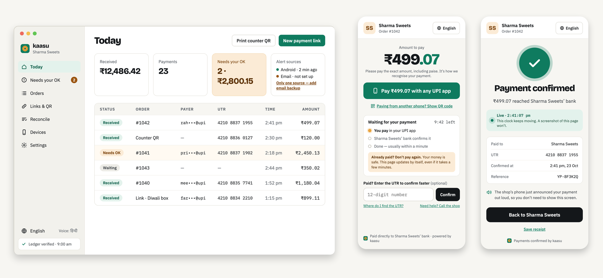

<p align="center">
  <picture>
    <source media="(prefers-color-scheme: dark)" srcset="assets/brand/kaasu-logo-dark.png">
    
  </picture>
</p>

<h3 align="center">Take UPI payments. Keep every rupee.</h3>

<p align="center">
  Open-source, self-hosted payment confirmation for small Indian shops.<br>
  Customers pay with any UPI app, money lands straight in your bank, and Kaasu confirms the order.
</p>

<p align="center">
  <a href="LICENSE"></a>
  <a href="https://github.com/opensawce/kaasu/milestones"></a>
  
</p>

<p align="center">
  <a href="#quick-start">Quick start</a> ·
  <a href="#how-it-works">How it works</a> ·
  <a href="design.md">Design</a> ·
  <a href="architecture.md">Architecture</a> ·
  <a href="https://github.com/opensawce/kaasu/milestones">Roadmap</a> ·
  <a href="#contributing">Contributing</a>
</p>



> [!NOTE]
> **Pre-alpha, built in the open.** Not ready for real money yet. Follow the [roadmap](https://github.com/opensawce/kaasu/milestones).

## Why Kaasu


- **0% fees.** No gateway in the middle. Money goes from your customer's bank to yours.
- **Hear every payment.** "₹499 received" spoken on your phone, in your language.
- **Hard to fool.** Signed bank alerts, exact-amount + UTR matching, a tamper-evident ledger, and a review queue for anything doubtful.
- **Yours.** One Go binary and a SQLite file on your laptop, server or Railway. No account with us.

## How it works

1. **Your shop creates an order.** Kaasu gives it a unique amount, like ₹499.07.
2. **The customer pays** with any UPI app, by link or QR.
3. **Your bank sends its usual alert.** The Kaasu Forwarder on your Android phone (or your email) passes it on, signed.
4. **Kaasu matches it** by amount, UTR and time, confirms the order, sends your shop a webhook and says it out loud. Anything that doesn't line up waits for your OK.


## Features

| Area | What you get |
|---|---|
| **Checkout** | Pay page · payment links · printable counter QR · JS snippet · WooCommerce plugin |
| **Confirmation** | Android Forwarder (SMS + app alerts) · bank email with DKIM · Mac Messages agent · cross-source dedupe |
| **Merchant tools** | Web dashboard (installable) · iPhone, Mac and Windows apps · review queue · reconciliation · refund log |
| **Trust** | Passkey sign-in · hash-chained ledger · signed webhooks · signed, reproducible releases |
| **Languages** | English, हिन्दी, தமிழ், తెలుగు, ಕನ್ನಡ, മലയാളം, मराठी, বাংলা, ગુજરાતી, ਪੰਜਾਬੀ, ଓଡ଼ିଆ |
| **AI (optional)** | Bring your own key or run a local model. Never confirms payments. |

## Quick start

> [!IMPORTANT]
> Lands with [#2](https://github.com/opensawce/kaasu/issues/2) and [#51](https://github.com/opensawce/kaasu/issues/51). The commands below are the target.

```bash
git clone https://github.com/opensawce/kaasu && cd kaasu
make dev
```

Runs everything offline with a demo shop and a payment simulator. Then fire a fake bank alert:

```bash
kaasu sim exact-match
```

### Run it for your shop

| Option | Best for |
|---|---|
| Mac or Windows app | Easiest. Keep the computer on. |
| One-line install on a Linux server | Recommended. Always on, HTTPS and backups set up for you. |
| Docker | Developers |
| Railway one-click | No server to manage |

## Limits

- Kaasu reads bank alerts; it is not connected to your bank. Alerts can be late or missing, so reconcile against your statement.
- Built for low-volume shops. Not a licensed payment gateway.
- Check your bank's terms for business use of your account.

## Docs

- [`design.md`](design.md): product, brand and UI spec
- [`architecture.md`](architecture.md): system design, API, security
- [`AGENTS.md`](AGENTS.md): rules for contributors and AI coding agents
- [System design in Eraser](https://app.eraser.io/workspace/DGtR2KRhH2uuKnljVGsC): editable diagrams

## Contributing

Code, bank alert formats, translations and docs are all welcome. Start with [`CONTRIBUTING.md`](CONTRIBUTING.md): how to pick up an issue, the PR process, the one-click [CLA](CLA.md), and the AI-assisted coding policy (AI is fine; you own every line).

## Security

Please report vulnerabilities privately through [GitHub Security Advisories](https://github.com/opensawce/kaasu/security/advisories/new), not public issues.

## License

[AGPL-3.0](LICENSE) © OpenSawce. A commercial license is available for uses the AGPL doesn't fit.
