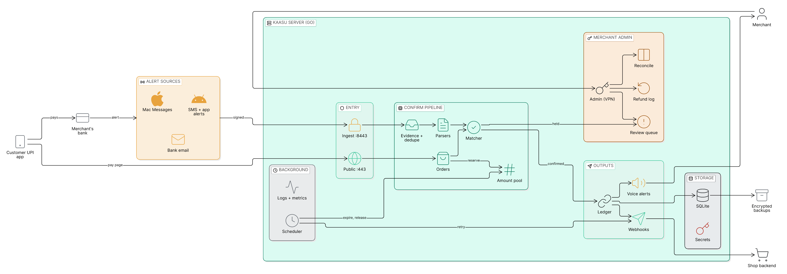
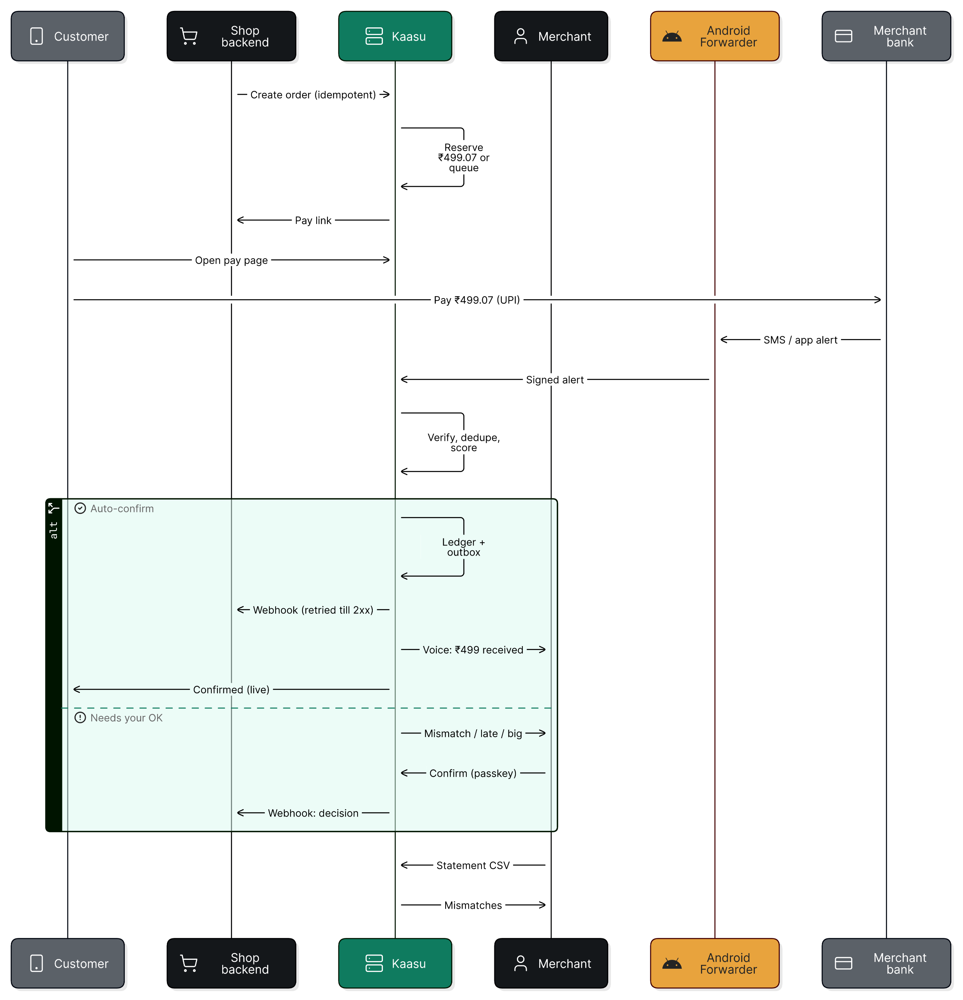
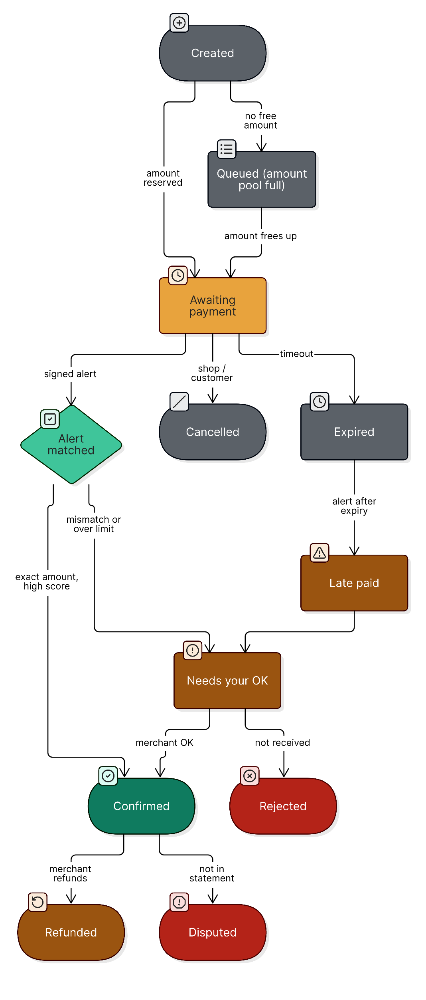
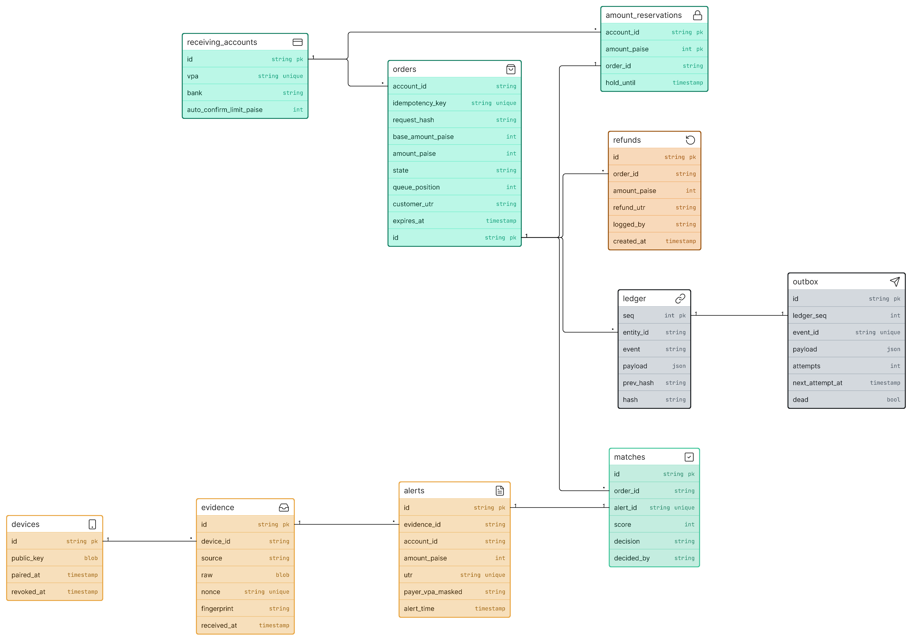
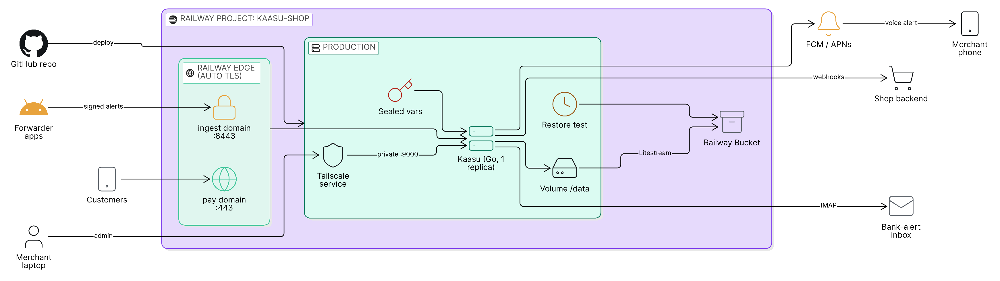
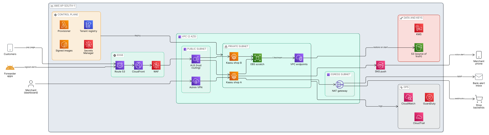

# Kaasu architecture

How Kaasu is built: system design, API, security and AI rules. Product, brand and UI live in [`design.md`](design.md). Spec only.

**Contents:** [System](#1-system) · [API & webhooks](#2-api--webhooks) · [Security](#3-security) · [AI](#4-ai) · [Threat model](#5-threat-model)

---

## 1. System

Diagrams are drawn in Eraser. Source: `assets/diagrams/*.eraser` · Images: `assets/diagrams/*.png` · Live file: [Kaasu: System design](https://app.eraser.io/workspace/DGtR2KRhH2uuKnljVGsC).

### Architecture

### Payment flow

### Order states

### Data model

### Deployment
| Option | Diagram |
|---|---|
| Self-host (VPS, Mac, Windows) | Architecture above |
| Railway (one project per shop) |  |
| Kaasu Cloud on AWS (ap-south-1) |  |

---

## 2. API & webhooks

- REST under `/v1`, API key per shop, `Idempotency-Key` required on create.
- Money fields are integer paise.
- UPI intent link for personal VPAs: `pa, pn, am, cu, tn` only.
- Webhook header `X-Kaasu-Signature: t=<unix>,v1=<HMAC-SHA256(secret, t.body)>`; unique `event_id`; at-least-once delivery.
- Events: `order.confirmed`, `order.review`, `order.rejected`, `order.expired`, `order.cancelled`, `order.refunded`, `order.disputed`.
- Full spec: `openapi.yaml`.

---

## 3. Security

- Three listeners: public, ingest (signed devices only), admin (localhost/VPN only).
- Device alerts: Ed25519 signature over body hash + timestamp + nonce; replay window 60 s; revocable.
- Email alerts: DKIM verified on raw message; bank domain allowlist.
- Admin: passkeys, TOTP fallback; re-auth for sensitive actions.
- Secrets: envelope-encrypted; master key outside the database; API keys hashed.
- Ledger: append-only, hash-chained, verified by `kaasu verify`.
- Customer pages: strict CSP, no third-party JS.
- Releases: reproducible, signed, SBOM.

---

## 4. AI

- Optional, off by default; merchant's own key or local model.
- Never confirms payments or changes order state.
- Inputs masked; structured output only; no tools.
- Every suggestion stored in the ledger with the model name.
- Features: unknown-format fallback (→ review), statement import, Ask your shop.

---

## 5. Threat model

**Protect:** the truth of "this order is paid", payer and account data, the ledger, admin access, signing keys and releases.
**Trust:** the merchant's own server and the bank's signed alert. **Do not trust:** customers, payer-supplied text (UPI note, UTR, name), forwarded devices until paired, webhook receivers, any LLM output.

| # | Threat | Defence | Test (#57) |
|---|---|---|---|
| T1 | Fake payment: forged screenshot, hand-typed UTR, made-up alert | Only `internal/match` confirms, and only from a verified alert; manual UTR goes to review | Forged and unsigned alerts never confirm |
| T2 | Replayed or edited device alert | Ed25519 over body hash, timestamp and nonce; 60 s window; nonce store | Replay, clock skew, tampered body rejected |
| T3 | Spoofed bank email | DKIM on the raw message; bank domain allow-list | Bad signature and look-alike domain ignored |
| T4 | Wrong order matched (amount collision, late alert) | Unique paise per open order; ambiguous or late matches go to review | Collision and late-alert scenarios |
| T5 | Ledger tampering by an admin or a stolen database | Append-only, hash-chained rows; state change and ledger row in one transaction; `kaasu verify` | Edited row breaks the chain |
| T6 | Admin takeover | Passkeys, TOTP fallback, re-auth for sensitive actions, admin listener not public | Admin routes absent on public and ingest listeners |
| T7 | Secret theft from disk or backup | Envelope encryption; master key outside the database; API keys hashed | Dump contains no plaintext secrets |
| T8 | Payer data leak | Masked VPA and account everywhere except the evidence store; masked logs | Log and response scans for full VPAs |
| T9 | Webhook forgery or replay by a third party | `X-Kaasu-Signature` over `t.body`; unique `event_id`; at-least-once | Bad signature and old timestamp rejected |
| T10 | Prompt injection through alert text | LLM has no tools, never sees raw alert text, cannot change state; output is structured only | Injection corpus changes nothing |
| T11 | Customer page abuse (XSS, clickjacking, third-party script) | Strict CSP, no third-party JS, output escaping | CSP header and injection tests |
| T12 | Poisoned release or dependency | Reproducible signed builds, SBOM, pinned CI actions, Dependabot, CodeQL | Release verifies against its signature |
| T13 | Denial of service on the counter | Rate limits per door, bounded queues, single-writer SQL with short transactions | Load test keeps confirmations flowing |

**Accepted risks:** a compromised merchant server can lie to its own shop; a bank that never sends alerts leaves orders waiting, never paid; the owner's own approval in "Needs your OK" is final and is recorded.

**Review:** update this table in any PR that changes a defence above. An independent audit is tracked in #78.

